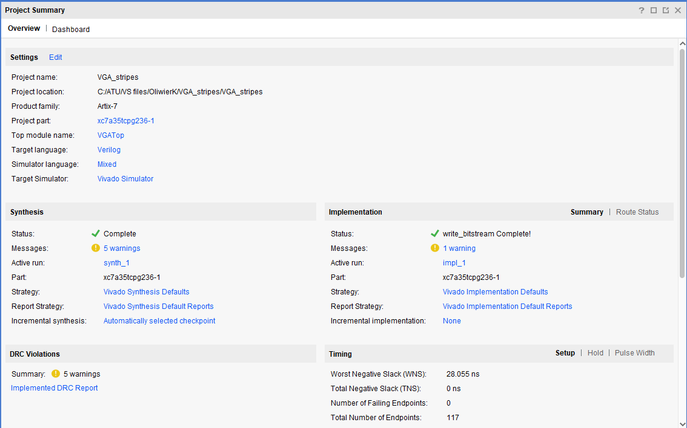
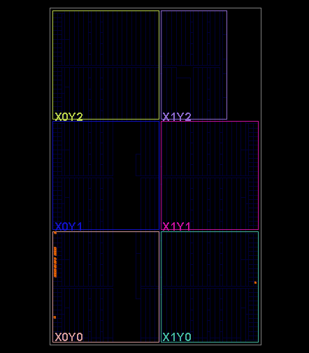

This project drives a VGA monitor from a Basys3 FPGA board using Verilog. A timing module generates the 640×480 @ 60 Hz sync signals, and a pattern module chooses the colour of each pixel.
The template draws eight vertical colour stripes. My own design replaces them with an animated sunset over water, with reflection bands that drift down the screen.

## **Template VGA Design**


## **Project Set-Up**
The project was created in Vivado for the Basys3 board (Artix-7 xc7a35tcpg236-1) with VGATop as the top module.
The design sources are VGATop.v, VGASync.v (horizontal and vertical counters that generate hSync, vSync and the vid_on visible-area flag) and VGAColourStripes.v (eight 80-pixel-wide colour bars chosen from the column count). A Clocking Wizard IP (clk_wiz_0) converts the board’s 100 MHz clock to the 25 MHz pixel clock. Basys3_Master.xdc was added as the constraints file to assign the clock, reset switch and VGA pins and set LVCMOS33 I/O standards. The testbench was run in simulation to check the sync timing. 
The design then went through synthesis, implementation and bitstream generation, and the resulting .bit file was programmed onto the board through Hardware Manager.
 This produced eight vertical colour stripes at 640×480 on the monitor.




### **Template Code**

A VGA monitor has no memory of the picture. It is sent one pixel at a time, left to right and top to bottom, about 60 times a second. Two sync signals tell it where it is: hsync marks the start of a new line and vsync marks the start of a new frame. Three colour signals (red, green and blue) say what colour the current pixel is. Around the visible 640×480 area there are extra blanking pixels and lines (the front porch, sync pulse and back porch), so each line is really 800 pixels and each frame 525 lines. With a 25 MHz pixel clock this gives about 59.5 frames per second.

VGASync generates this timing with two counters. The horizontal counter counts 0 to 799 and the vertical counter goes up by one each time it wraps, counting 0 to 524. From these it produces hsync (low for 96 pixels), vsync (low for 2 lines) and vid_on, which is high only while the counters are inside the visible 640×480 area. The counters are also output as col and row, so the rest of the design knows which pixel is being drawn.

ColourStripes uses col to choose the colour. The screen is split into eight bars, each 80 pixels wide, and each bar turns the red, green and blue channels fully on or off to make black, blue, green, cyan, red, magenta, yellow and white. VGATop connects the modules together and uses the Clocking Wizard to turn the 100 MHz board clock into the 25 MHz pixel clock. It also forces the colour outputs to zero whenever vid_on is low, because the monitor needs black during the blanking periods. The Basys3 board then converts each 4-bit colour value into an analogue voltage for the VGA connector.
### **Simulation**


The testbench (Testbench.v) instantiates VGASync and ColourStripes, drives a clock and holds reset for two clock cycles. It clocks the design directly, so one 10 ns cycle stands in for one pixel and a full line takes 800 x 10 ns = 8 µs. The waveform above is zoomed in on the end of line 0. vid_on drops at about 6.4 µs, once col passes 639. hsync goes low at about 6.575 µs and returns high at about 7.535 µs, a pulse of 96 clock cycles. Both edges sit one clock later than the counter values in the code (657 and 753), because VGASync registers its outputs. vsync stays high here because it only goes low at line 490, about 3.9 ms in. The colour outputs show F, 8, 4 (the sky colour of my edited design), because the simulation was run after I changed the code.
### **Synthesis**



Synthesis turns the Verilog into a netlist of basic FPGA building blocks. The logic becomes look-up tables (LUTs), the registers (the horizontal and vertical counters and the colour registers) become flip-flops, and the Clocking Wizard provides the 25 MHz pixel clock. Vivado also reads the constraints file here, so it knows which pins the signals use and that the input clock runs at 100 MHz.

Implementation then fits that netlist onto the real Artix-7 chip. It optimises the design, places each LUT and flip-flop in a physical location, and routes the wires between them. The image above shows the placed design in Vivado's Device view. It is a small design, so it only uses a tiny part of the chip. After routing, Vivado checks timing, which means every signal must settle within one clock period. The design passed with positive slack (worst case about 28 ns). The last step is writing the bitstream, the file that configures the FPGA.
### **Demonstration**

The template design running on the Basys3 board is shown at the top of this page: eight vertical colour stripes at 640×480, in the order set by ColourStripes (black, blue, green, cyan, red, magenta, yellow and white).

## **My VGA Design Edit**

For my own design I replaced the colour stripes with a simple picture: a sunset over water. It has an orange sky, a half-circle sun sitting on the horizon, and blue water below with yellow reflection bands that get wider towards the bottom. To make it more interesting I animated the reflection so the bands drift down the screen. I sketched the picture in Paint at 640×480 first, to work out where the shapes should go.

I expected this to be achievable because only ColourStripes has to change. VGASync already gives the row and column of every pixel, so the picture can be described with simple rules. The horizon at row 300 splits sky from water, the sun is every pixel within a distance of 80 from one centre point (a circle test), and the reflection is a set of bands whose width grows with the row. The animation needs one extra counter that moves the bands down every couple of frames. The main limits are that each colour channel only has 4 bits (16 levels), so colours can only be approximated, and that the logic has to stay simple enough to finish within one 25 MHz pixel clock. For background I used the [VGA article on Wikipedia](https://en.wikipedia.org/wiki/Video_Graphics_Array) for the signal timing and the [Digilent Basys3 reference manual](https://digilent.com/reference/programmable-logic/basys-3/reference-manual) for how the board's VGA port turns 4-bit colours into voltages.

### **Code Adaptation**

Only ColourStripes.v was changed. VGATop, VGASync and the testbench are the same as the template, and the module name and ports were kept so everything still connects. The template compares col against eight ranges. My version uses both row and col. Rows above 300 are sky and the rest is water, the sun is a half circle of radius 80 centred on column 320 at the horizon, and the reflection is four bands, each 24 lines tall with 28 lines between them. The bands get wider towards the bottom, from a half-width of 80 pixels at the horizon to about 120 at the last line. The colours are 4-bit values: F, 8, 4 for the sky, F, D, 8 for the sun and reflection, and 5, C, E for the water.

The sun uses a circle test. A pixel is inside the sun if (col - 320)² + (row - 300)² is at most 80², and the test is only applied above the horizon so it shows as a half circle. For the animation, a frame counter ticks once per frame (when row and col are both 0) and moves an offset up by one every two frames. A phase counter counts 0 to 51 down the water on each line, and the reflection is drawn while the phase is below 24. Changing where the phase starts slides all the bands down together. Using a counter avoids a modulo operation, which would be expensive in hardware.

```verilog
// Sun: half circle above the horizon (radius 80, centre column 320, horizon row 300)
wire in_sun = (row < 300) && (dist2 <= 6400);

// Reflection: lit while phase < 24 (the pattern repeats every 52 lines)
wire in_band = (row >= 300) && (phase < 24);
wire in_refl = in_band && (adx < hw);   // hw = half-width, grows with the row
```

### **Simulation**

The new design was simulated with the same testbench, since only ColourStripes changed. The sync timing is identical to the template, so the new thing to check is the animation. One frame takes about 4.2 ms of simulated time (800 x 525 x 10 ns) and the bands only move one step every second frame, so the simulation has to run for about 10 ms before anything changes. The waveform shows the offset counter inside ColourStripes stepping up as the frames go by, which is what makes the reflection bands slide down.

> **TODO:** Run the simulation for 10 ms or more, add the offset counter from ColourStripes to the waveform, and add a screenshot here. Edit the paragraph above if your waveform looks different.

### **Synthesis**

The new design went through the same synthesis and implementation steps. It finished with 5 synthesis warnings and 1 implementation warning, none of them a problem (for example the clock wizard's unused locked output and the unused rst input of VGASync). It uses 101 LUTs (0.49% of the chip), 45 flip-flops (0.11%), 2 DSP blocks and 1 clock manager, and timing passes with a worst slack of 28.055 ns.

The main difference from the template is the DSP blocks. The circle test multiplies numbers (dx × dx + dy × dy), and Vivado maps multiplications onto the chip's dedicated DSP blocks. The template only compares numbers, so it needs none. This is also what triggers the DSP pipelining warnings in the DRC report. The animation counters add a few more flip-flops, but the design is still tiny, and the large slack means there is plenty of timing margin at 25 MHz.

> **TODO:** Optional: add the stripes version's LUT and flip-flop counts for a direct comparison (re-run synthesis with the original VGAColourStripes.v), and a screenshot of the utilisation report.

### **Demonstration**

The sunset design running on the Basys3 board. The reflection bands drift down the screen, one step every two frames.

<video src="https://raw.githubusercontent.com/OliwierKardynal/fpga-vga-verilog/main/docs/assets/images/VGASunsetDemo.mp4" controls muted loop autoplay playsinline width="640"></video>
