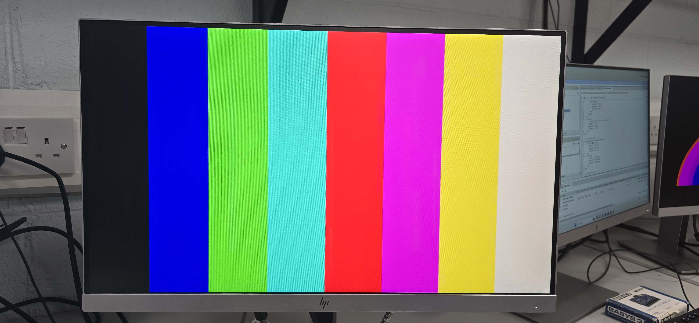
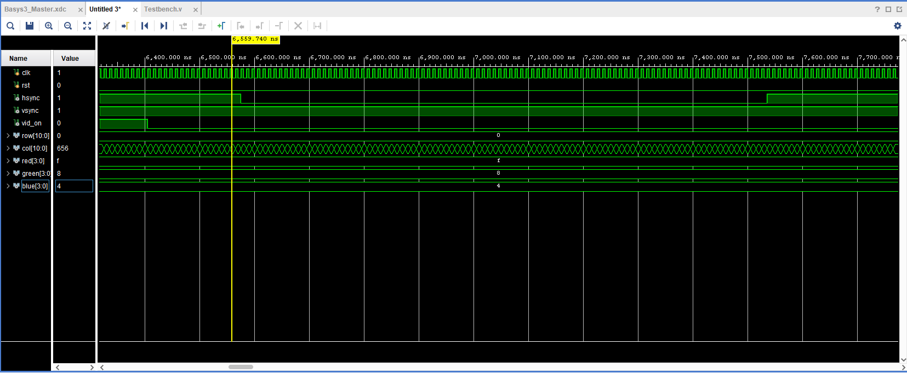

This project drives a VGA monitor from a Basys3 FPGA board using Verilog. A timing module generates the 640×480 @ 60 Hz sync signals, and a pattern module chooses the colour of each pixel.
The template draws eight vertical colour stripes. My own design replaces them with an animated sunset over water, with reflection bands that drift down the screen.

## **Template VGA Design**

## **Project Set-Up**
The project was created in Vivado for the Basys3 board (Artix-7 xc7a35tcpg236-1) with VGATop as the top module.
The design sources are VGATop.v, VGASync.v (horizontal and vertical counters that generate hSync, vSync and the vid_on visible-area flag) and VGAColourStripes.v (eight 80-pixel-wide colour bars chosen from the column count). A Clocking Wizard IP (clk_wiz_0) converts the board’s 100 MHz clock to the 25 MHz pixel clock. Basys3_Master.xdc was added as the constraints file to assign the clock, reset switch and VGA pins and set LVCMOS33 I/O standards. The testbench was run in simulation to check the sync timing. 
The design then went through synthesis, implementation and bitstream generation, and the resulting .bit file was programmed onto the board through Hardware Manager.
 This produced eight vertical colour stripes at 640×480 on the monitor.

### **Template Code**
Outline the structure and design of the Verilog code templates you were given. What do they do? Include reference to how a VGA interface works. Guideline: 2/3 short paragraphs, consider including screenshot(s).

A VGA monitor has no memory of the picture. It is sent one pixel at a time, left to right and top to bottom, about 60 times a second. Two sync signals tell it where it is: hsync marks the start of a new line and vsync marks the start of a new frame. Three colour signals (red, green and blue) say what colour the current pixel is. Around the visible 640×480 area there are extra blanking pixels and lines (the front porch, sync pulse and back porch), so each line is really 800 pixels and each frame 525 lines. With a 25 MHz pixel clock this gives about 59.5 frames per second.

VGASync generates this timing with two counters. The horizontal counter counts 0 to 799 and the vertical counter goes up by one each time it wraps, counting 0 to 524. From these it produces hsync (low for 96 pixels), vsync (low for 2 lines) and vid_on, which is high only while the counters are inside the visible 640×480 area. The counters are also output as col and row, so the rest of the design knows which pixel is being drawn.

ColourStripes uses col to choose the colour. The screen is split into eight bars, each 80 pixels wide, and each bar turns the red, green and blue channels fully on or off to make black, blue, green, cyan, red, magenta, yellow and white. VGATop connects the modules together and uses the Clocking Wizard to turn the 100 MHz board clock into the 25 MHz pixel clock. It also forces the colour outputs to zero whenever vid_on is low, because the monitor needs black during the blanking periods. The Basys3 board then converts each 4-bit colour value into an analogue voltage for the VGA connector.
### **Simulation**
Explain the simulation process. Reference any important details, include a well-selected screenshot of the simulation. Guideline: 1/2 short paragraphs.

The testbench (Testbench.v) instantiates VGASync and ColourStripes, drives a clock and holds reset for two clock cycles. It clocks the design directly, so one 10 ns cycle stands in for one pixel and a full line takes 800 x 10 ns = 8 µs. The waveform above is zoomed in on the end of line 0. vid_on drops at about 6.4 µs, once col passes 639. hsync goes low at about 6.575 µs and returns high at about 7.535 µs, a pulse of 96 clock cycles. Both edges sit one clock later than the counter values in the code (657 and 753), because VGASync registers its outputs. vsync stays high here because it only goes low at line 490, about 3.9 ms in. The colour outputs show F, 8, 4 (the sky colour of my edited design), because the simulation was run after I changed the code.
### **Synthesis**
Describe the synthesis and implementation processes. Consider including 1/2 useful screenshot(s). Guideline: 1/2 short paragraphs.

Synthesis turns the Verilog into a netlist of basic FPGA building blocks. The logic becomes look-up tables (LUTs), the registers (the horizontal and vertical counters and the colour registers) become flip-flops, and the Clocking Wizard provides the 25 MHz pixel clock. Vivado also reads the constraints file here, so it knows which pins the signals use and that the input clock runs at 100 MHz.

Implementation then fits that netlist onto the real Artix-7 chip. It optimises the design, places each LUT and flip-flop in a physical location, and routes the wires between them. The image above shows the placed design in Vivado's Device view. It is a small design, so it only uses a tiny part of the chip. After routing, Vivado checks timing, which means every signal must settle within one clock period. The design passed with positive slack (worst case about 28 ns). The last step is writing the bitstream, the file that configures the FPGA.
### **Demonstration**
Perhaps add a picture of your demo. Guideline: 1/2 sentences.

> **TODO:** Add a sentence or two. The stripes photo (1000022117.png) is already used under "Template VGA Design", so you may want to move it here.

## **My VGA Design Edit**
Introduce your own design idea. Consider how complex/achievabble this might be or otherwise. Reference any research you do online (use hyperlinks).

> **TODO:** Not written yet. Describe the sunset idea and add at least one hyperlink to your research.

### **Code Adaptation**
Briefly show how you changed the template code to display a different image. Demonstrate your understanding. Guideline: 1-2 short paragraphs.

> **TODO:** Not written yet. Explain how ColourStripes was changed (sun, horizon, reflection bands, drift animation) and add a short code snippet.

### **Simulation**
Show how you simulated your own design. Are there any things to note? Demonstrate your understanding. Add a screenshot. Guideline: 1-2 short paragraphs.

> **TODO:** Not done yet. Simulate the new design and add a screenshot. The drift animation only moves once per frame, so run the simulation for several frames.

### **Synthesis**
Describe the synthesis & implementation outputs for your design, are there any differences to that of the original design? Guideline 1-2 short paragraphs.

> **TODO:** Not done yet. Re-run synthesis and implementation on the new design and compare its utilisation and timing with the stripes version.

### **Demonstration**
If you get your own design working on the Basys3 board, take a picture! Guideline: 1-2 sentences.

The sunset design running on the Basys3 board. The reflection bands drift down the screen, one step every two frames.

<video src="https://raw.githubusercontent.com/OliwierKardynal/fpga-vga-verilog/main/docs/assets/images/VGASunsetDemo.mp4" controls muted loop autoplay playsinline width="640"></video>

## **More Markdown Basics**
> **TODO:** This section is template text (it also links images from the template author's repository). Delete it before submitting.

This is a paragraph. Add an empty line to start a new paragraph.

Font can be emphasised as *Italic* or **Bold**.

Code can be highlighted by using `backticks`.

Hyperlinks look like this: [GitHub Help](https://help.github.com/).

A bullet list can be rendered as follows:
- vectors
- algorithms
- iterators

Images can be added by uploading them to the repository in a /docs/assets/images folder, and then rendering using HTML via githubusercontent.com as shown in the example below.

